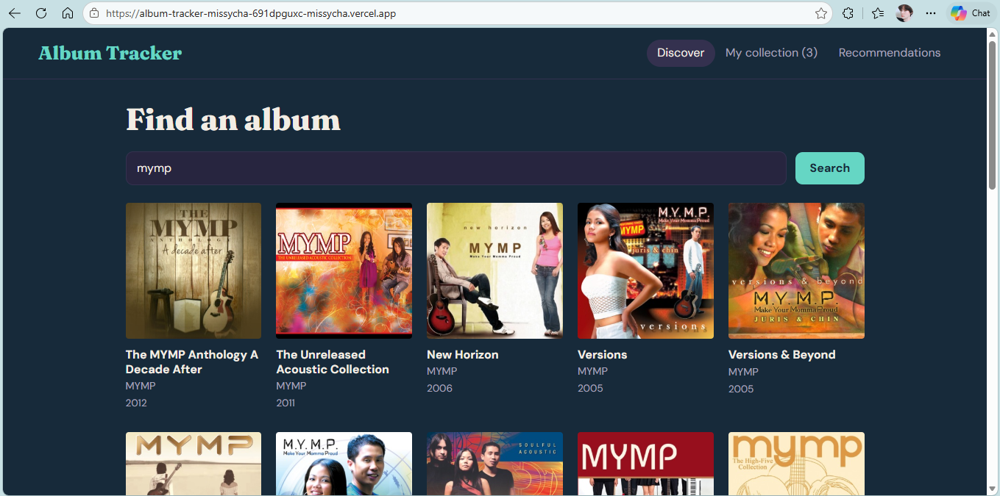

# Album Tracker

## Project Description

Album Tracker is a web application built with React that allows users to search for music albums, explore album details, listen to available music previews, and manage their personal music collection. It also provides Deezer album playback options and AI-powered recommendations based on the user's saved albums and ratings.

## Live Website

(https://album-tracker-missycha-691dpguxc-missycha.vercel.app/)

## Screenshot

## Features

- Album Search: Search for albums using the iTunes API.
- Album Details: View album information, artwork, and track listings.
- Music Player: Play, pause, skip, and seek through available 30-second previews.
- Personal Collection: Save albums and manage their listening status, ratings, and notes.
- Filter and Sort: Organize saved albums based on different criteria.
- Local Storage: Keep saved albums in the browser even after refreshing.
- Deezer Integration: Access the Deezer embedded player when a matching album is available.
- AI Recommendations: Receive album recommendations based on saved albums and ratings using Google's Gemini API.

## Tech Stack

- React
- Vite
- JavaScript
- CSS
- React Context API
- iTunes Search API
- Deezer API and Embedded Widget
- Google Gemini API
- Vercel

## How to Run Locally

1. Clone the repository:

   `git clone https://github.com/missycha/album-tracker.git`

2. Open the project folder:

   `cd album-tracker`

3. Install the dependencies:

   `npm install`

4. Create a `.env.local` file in the project root and add your Gemini API key:

   `GEMINI_API_KEY=your_api_key_here`

5. Start the development server:

   `npm run dev`

6. Open the local address provided by Vite, usually `http://localhost:5173`.

## Limitations

- iTunes provides only 30-second music previews.
- The personal collection is saved in the user's browser and is not synchronized across devices.
- Full album playback through Deezer may require a Deezer login and depends on account and regional availability.
- AI recommendations depend on the availability of the Gemini API.

## AI Privacy Note

The AI recommendation feature sends saved album titles, artists, ratings, and listening statuses to Google's Gemini API to generate music recommendations. Personal notes are not included in the request.

## Disclaimer

This project is developed for educational purposes and is not affiliated with, endorsed by, or sponsored by Apple, Spotify, Deezer, or Google.
